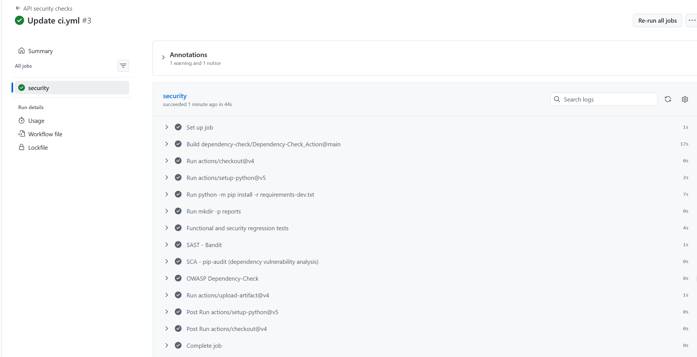
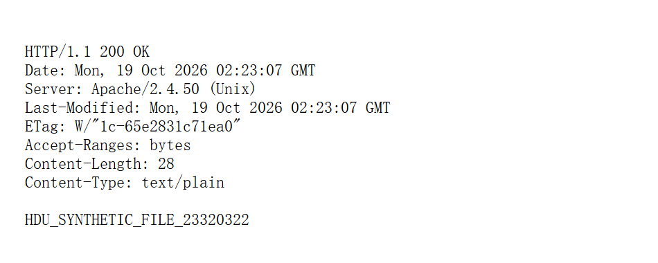
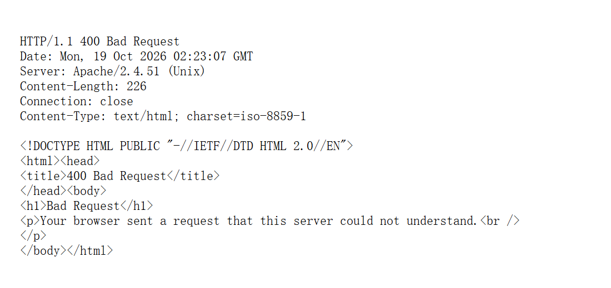

# Secure Course Notes API

Chen Er Huo | HDU 23320322 | Lab 1

## Run

Use Python 3.12. Create a virtual environment and run `python -m pip install -r requirements-dev.txt`.
Set API_JWT_SECRET to an independent cryptographically random secret of at least 32 characters. Never commit it.
Set API_DATABASE to a writable local SQLite path. Provision a synthetic account with `provision_user(create_app(), login, password)` locally; no production credentials are included. Run `python app.py` to listen on 127.0.0.1:5055. This development server is for the lab, not production.

## Endpoints

* POST /auth/login: JSON {"login":"<synthetic account>","password":"<local password>"}. Returns a 15-minute HS256 JWT on success; invalid credentials return 401.
* GET /api/data: Authorization: Bearer <JWT>. Returns only the authenticated user's notes. Missing or invalid tokens return 401.
* POST /api/notes: same Bearer header; JSON {"body":"example"}. Creates a note for the authenticated owner, returns 201. Body must contain 1–500 characters.

## Security design

SQLite queries bind all request data as parameters. User input never forms SQL syntax. Passwords are salted scrypt hashes generated by Werkzeug; no plaintext passwords are stored. Unknown users still undergo a dummy hash check. JWT verification permits only HS256 and requires exp, iat, sub, issuer and audience. The user must still exist. Authentication applies to both data routes. Ownership comes from the verified subject, not a caller-supplied owner field.

All returned note bodies are escaped with MarkupSafe; responses use application/json, nosniff, no-store and a restrictive CSP. A frontend should still use textContent instead of treating JSON as HTML; escaping JSON here is a course requirement, not a universal replacement for context-aware output encoding. Request size, field type and length are bounded. The lab omits production TLS termination, rate limiting and token revocation; these are remaining deployment controls, not implemented features.

## Verification and CI

`python -m pytest -q` runs twelve collected cases covering login, unauthenticated access, ownership, SQLi attempts, XSS encoding, invalid/expired/unsigned JWTs, limits and hash storage.

`python -m bandit -r app.py -f json -o reports/bandit.json`

`python -m pip_audit --no-deps --disable-pip -r requirements-lock.txt -f json -o reports/pip-audit.json`

The lock lists all eight runtime distributions for auditing. Local results: twelve tests passed; Bandit has no remaining findings; pip-audit reports no known vulnerabilities for these eight versions at retrieval. This is not proof of complete security. Initial Bandit B106 flagged the literal Bearer token type as a password-like keyword argument; the JSON construction was clarified without suppressing the rule. An initially empty dependency report was rejected and replaced by the populated lock audit.

.github/workflows/ci.yml runs tests, Bandit, pip-audit and OWASP Dependency-Check on pushes and pull requests, and uploads reports even on failure. Dependency-Check uses the official project action with experimental Python analyzers. Its NVD data availability and ecosystem coverage must be reviewed in the real run; pip-audit provides Python-specific composition analysis in addition.

**Remote verification (20 October 2026):** Public repository: https://github.com/ccceh30/hdu-infosec-lab1 . Successful run #3 (commit e207013): https://github.com/ccceh30/hdu-infosec-lab1/actions/runs/39390989335 . The user-provided GitHub screenshot shows all job steps passed. Downloaded artifacts verify 12 tests, zero Bandit findings and eight Python runtime packages without known vulnerabilities at scan time. Dependency-Check 13.0.0 identifies two direct packages; it reports zero unsuppressed vulnerabilities and one documented false-product match suppressed. It does not cover all eight runtime dependencies; pip-audit provides the broader Python lock audit.

`dependency-check-suppressions.xml` excludes only CVE-2025-45770 for pkg:pypi/pyjwt@2.15.1 until 20 January 2027. The report incorrectly associates Python PyJWT with the PHP/Composer lcobucci/jwt product. The CVSS 7 failure threshold remains enabled; future findings still fail CI. The optional Sonatype OSS Index analyzer was disabled for missing credentials, so no coverage from that service is claimed. Original failed and successful artifacts and the genuine user-supplied Actions screenshot are retained with the submission.

## CVE-2021-42013 experiment

The repository includes the API project; the `cve-lab/` folder contains `fixes/`, `evidence/`, and `run_cve.sh`. The official Vulhub httpd/CVE-2021-42013 directory was cloned on E:. Its permissive root-directory and autoindex configuration was adapted to official httpd images with localhost listeners. CGI was deliberately not enabled: the measured result is file disclosure, not command execution. This is an adapted Vulhub configuration, not an unmodified upstream image build.

Docker Engine 28.5.1 and Compose 2.40.0 run inside existing WSL stored on E:. A local Unix socket is used; no TCP Docker API. Ports 8088 (2.4.50) and 8089 (2.4.51) bind only to 127.0.0.1 within WSL. The Compose file uses host networking because this lab daemon has no bridge/firewall integration. This configuration is specific to Linux/WSL.

1. Inspect the retained upstream Dockerfile and compose configuration in cve-lab/evidence.
2. Run the supplied run_cve.sh as the WSL administrator in this controlled lab. It produces the two local configurations and launches the comparison containers. The original command record also contains the actual Compose invocation; use fixes/compose.yml for subsequent runs.
3. Create `/tmp/hdu-proof.txt` inside each container with the same synthetic string `HDU_SYNTHETIC_FILE_23320322`.
4. Run: `curl -i --path-as-is 'http://127.0.0.1:8088/icons/.%%32%65/.%%32%65/.%%32%65/.%%32%65/tmp/hdu-proof.txt'`.
5. The vulnerable server returned HTTP 200 and the synthetic string from outside the public document root.
6. Change the image to the historical fixed 2.4.51 comparator, rebuild/restart or use the fixed Compose service, and repeat the exact path at port 8089. It returned HTTP 400. The ordinary homepage returned HTTP 200 for both versions.

Root cause: URL normalization accepted encoded dot segments that escaped an aliased directory after incomplete prior validation. The reproduction combines that implementation defect with an intentionally permissive filesystem access configuration. The version comparator rejects the malicious path while preserving ordinary requests. In production use a currently maintained release, deny root-directory access, explicitly allow only required paths and disable unnecessary CGI; 2.4.51 is a historical CVE-specific comparison, not a current production recommendation.

Actual command responses and browser captures are in cve-lab/evidence/traversal-8088.*, traversal-8089.*, homepage-*.txt and version-*.txt. They are local captures, not downloaded demonstration images. No real credentials or private host files were read.

Sources: https://github.com/vulhub/vulhub/tree/master/httpd/CVE-2021-42013 ; https://httpd.apache.org/security/vulnerabilities_24.html ; https://nvd.nist.gov/vuln/detail/CVE-2021-42013 ; https://cheatsheetseries.owasp.org/cheatsheets/SQL_Injection_Prevention_Cheat_Sheet.html ; https://docs.github.com/en/actions

## CI and CVE screenshots

The original account-owner screenshot shows the successful job for commit e207013. Downloaded pytest, Bandit, pip-audit and Dependency-Check reports are retained in the submission, including the failed pre-review run. The successful Dependency-Check report explicitly preserves one narrowly reviewed suppressed false product match.

